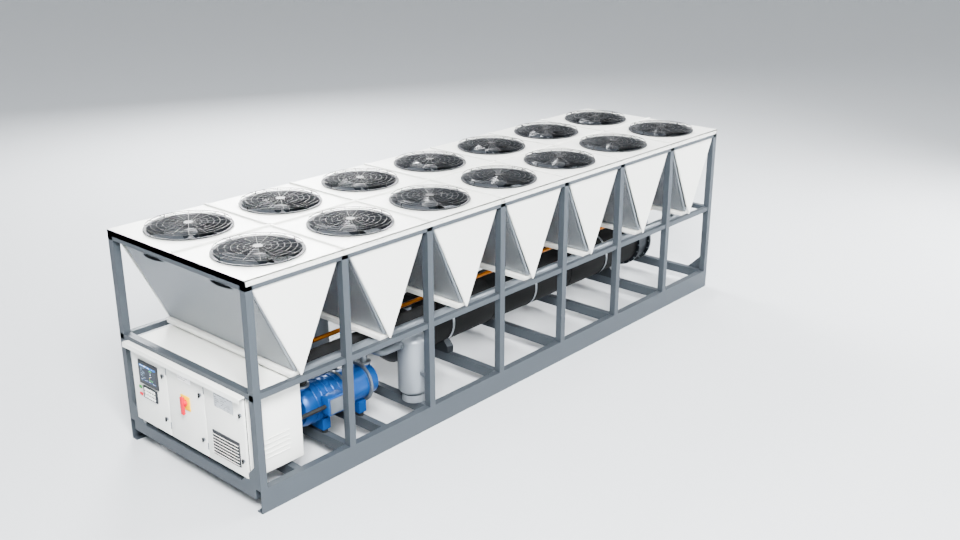
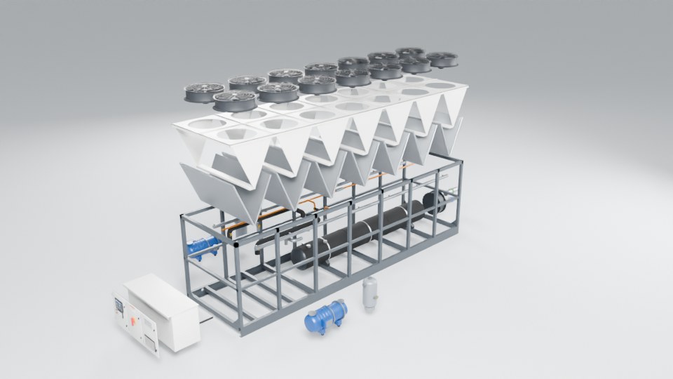
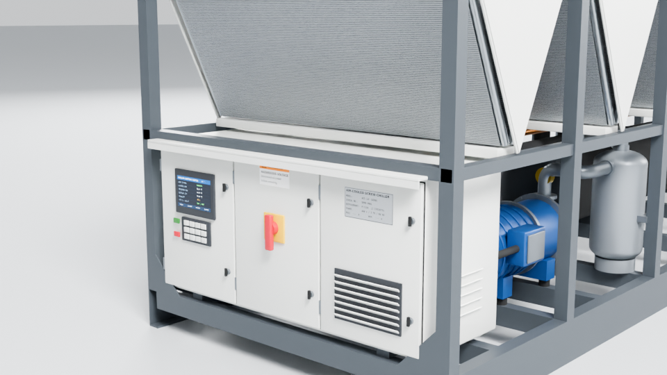
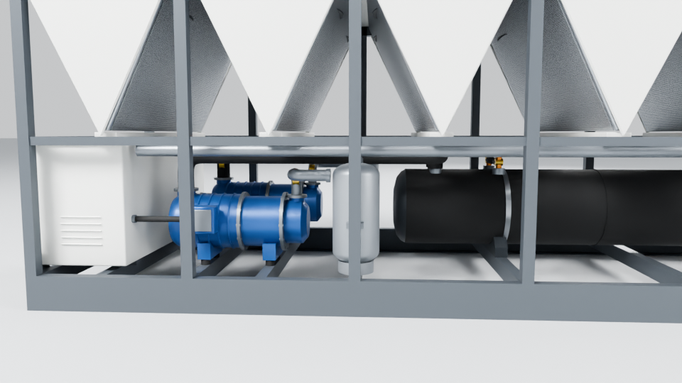
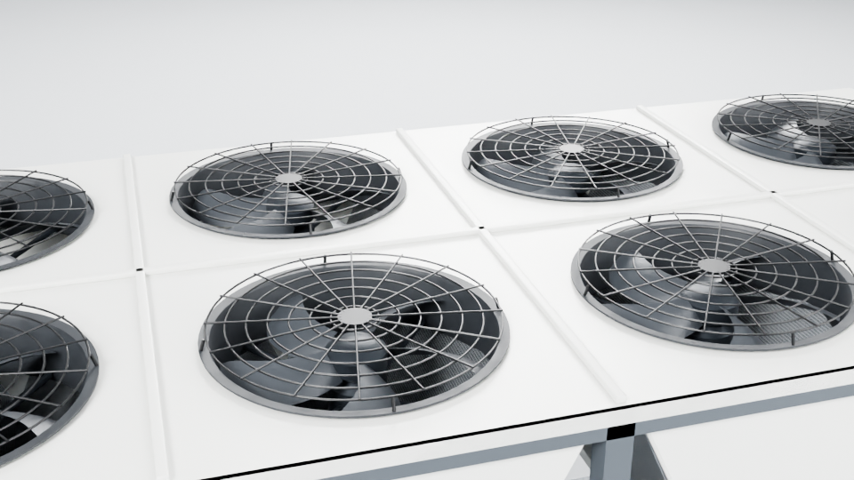

# Air-Cooled Screw Chiller: Interactive 3D Model (GLB)

A presentation model of a **14-fan, V-coil air-cooled screw chiller** (York YVAA-style layout).
It was built in **Blender 5.1** and exported as one **GLB** file in which every major component is
a **separate, named, clickable node**.



| Exploded view | Control panel end |
|---|---|
|  |  |
| **Machinery bay** | **Condenser fans** |
|  |  |

---

## Deliverables

| File | What it is |
|---|---|
| `chiller_aircooled_screw.glb` | **The model.** glTF 2.0 binary, Y-up, meters, PBR materials, embedded textures, fan animation |
| `blender/chiller_aircooled_screw.blend` | Blender source scene (textures packed) with a presentation camera and lights |
| `blender/build_chiller.py` | Parametric build script that regenerates the whole model and the GLB from parameters |
| `viewer/index.html` | Web demo (three.js): click to select, part tree, explode, isolate/hide, fan animation |
| `renders/*.png` | Cycles renders for the presentation deck |

## Model specification

| | |
|---|---|
| Overall size (L × W × H) | **8.19 × 2.24 × 2.41 m** (322 × 88 × 95 in) |
| Layout | 7 bays × 2 fans = 14 condenser fans, V-shaped microchannel coils |
| Refrigerant circuits | 2 (one compressor, oil separator and pipe set per circuit) |
| Geometry | ~160k triangles, 81 meshes, 26 PBR materials |
| File size | ~6 MB GLB, no Draco (opens in any viewer without a decoder) |
| Units / axes | meters, glTF Y-up (+X = length, toward the water connections) |
| Animation | `Fans_Spin`: one looping clip that turns all 14 fan rotors |

## Part structure (scene graph)

There are 9 top-level parts. Each one is an `Empty`/group node. Its **origin is at the part's
own center**, so it can be moved, exploded or animated as a unit. Sub-parts are child meshes.

```
Chiller_AirCooled_Screw                      (root, origin = ground center)
├── P01_Base_Frame          Base Frame                 Structure
│   └── Base_Frame_Structure
├── P02_Control_Panel       Control & Power Panel      Electrical
│   ├── Panel_Enclosure
│   ├── Panel_Door_1_Controls     (HMI display + keypad)
│   ├── Panel_Door_2_Disconnect   (main disconnect handle)
│   ├── Panel_Door_3_Power        (nameplate + louvers)
│   └── Power_Conduits
├── P03_Condenser_Coils     Condenser Coils            Heat Transfer
│   └── Coil_Bay_01 … Coil_Bay_07
├── P04_Casing_Fan_Deck     Casing & Fan Deck          Enclosure
│   ├── Fan_Deck
│   └── V_End_Panels
├── P05_Condenser_Fans      Condenser Fans             Air Moving
│   └── Fan_01 … Fan_14
│       ├── Fan_NN_Venturi
│       ├── Fan_NN_Rotor          (animated)
│       ├── Fan_NN_Motor
│       └── Fan_NN_Guard
├── P06_Compressors         Screw Compressors          Refrigeration
│   ├── Compressor_C1
│   └── Compressor_C2
├── P07_Oil_Separators      Oil Separators             Refrigeration
│   ├── Oil_Separator_C1
│   └── Oil_Separator_C2
├── P08_Evaporator          Evaporator                 Heat Transfer
│   ├── Evaporator_Shell
│   ├── Evaporator_Water_Box
│   ├── CHW_Inlet_Nozzle          (blue band = return)
│   └── CHW_Outlet_Nozzle         (green band = supply)
└── P09_Refrigerant_Piping  Refrigerant Piping         Refrigeration
    ├── Refrigerant_Circuit_1
    └── Refrigerant_Circuit_2
```

Node names use only `A–Z a–z 0–9 _`, so three.js, Babylon.js, Unity and Unreal import them unchanged.

### Metadata on every part (glTF `extras`)

Every part node carries metadata. In three.js it is available as `object.userData`:

```json
{
  "part_id": "P06",
  "display_name": "Screw Compressors",
  "category": "Refrigeration",
  "description": "Two semi-hermetic screw compressors (one per refrigerant circuit) on neoprene isolators.",
  "explode": [0, 0, 0]
}
```

* `description` is placeholder text. Replace it with the client's own wording, either in Blender
  (Object Properties → Custom Properties) or in the `assemble()` function of the build script.
* `explode` is an offset in glTF coordinates (meters) for an exploded view. A child node can have
  its own offset; for example, the two compressors move out to opposite sides.
* The root node also carries the overall dimensions (`length_mm`, `width_in`, …) and `units`.

## Using it in a web page (three.js)

```js
const gltf = await new GLTFLoader().loadAsync('chiller_aircooled_screw.glb');
scene.add(gltf.scene);

// Click → walk up to the part node that carries part_id
const hit = raycaster.intersectObject(gltf.scene, true)[0];
let part = hit?.object;
while (part && !part.userData.part_id) part = part.parent;
console.log(part.userData.part_id, part.userData.display_name, part.userData.description);

// Exploded view (t = 0…1)
gltf.scene.traverse(o => {
  if (o.userData.explode) {
    o.userData.home ??= o.position.clone();
    o.position.copy(o.userData.home).add(new THREE.Vector3(...o.userData.explode).multiplyScalar(t));
  }
});

// Fans
const mixer = new THREE.AnimationMixer(gltf.scene);
mixer.clipAction(gltf.animations[0]).play();
```

`viewer/index.html` is a complete working example. Serve the folder over HTTP, because browsers
block `file://` model loading:

```bash
cd chiller-3d-demo && npx serve .     # then open http://localhost:3000/viewer/
```

## Rebuilding / matching the manufacturer's drawing

All dimensions are parameters at the top of `blender/build_chiller.py` (bay count, bay pitch, width,
deck height, compressor and evaporator positions, and so on). To match a specific model's
submittal or IOM drawing, edit those values and run:

```bash
blender -b -P blender/build_chiller.py -- --render     # GLB + .blend + renders
blender -b -P blender/build_chiller.py --              # GLB + .blend only (~10 s)
```

The textures (microchannel coil, HMI screen, nameplate, safety label) are generated by the same
script into `blender/textures/`.

## Notes

* This is a presentation-level model. The geometry is representative of this class of unit and is
  not a certified reproduction of any manufacturer's design. The nameplate and screen show
  generic demo text, and no third-party logos are used.
* More detail can be added to any part without changing the node structure, for example
  VSD internals, valves, wiring, or lifting and rigging points. Integrations built on these node
  names keep working after an update.
